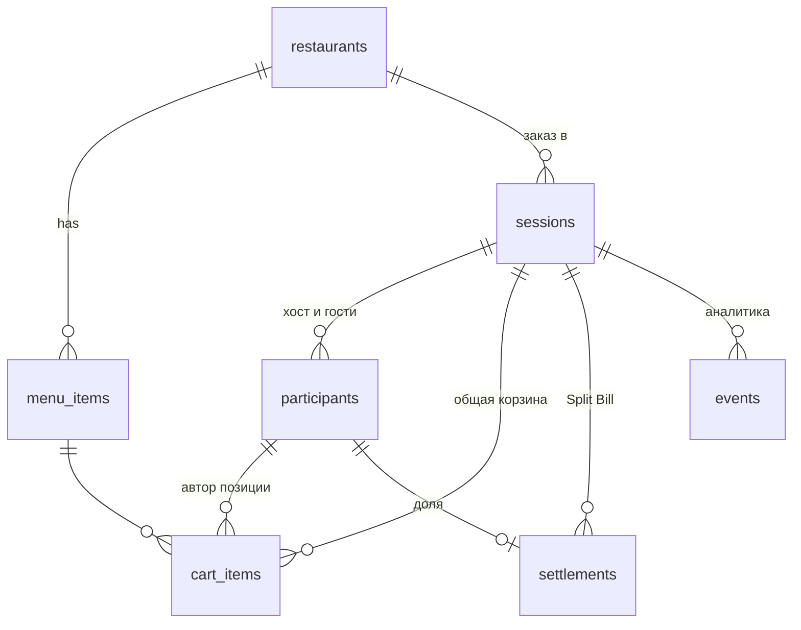

# Совместная корзина (Real-Time Group Order): рабочий прототип

Хост нажимает «Заказать компанией», получает ссылку и QR. Друзья открывают ссылку без установки и регистрации, вводят имя и выбирают блюда. Позиции без перезагрузки попадают в общую корзину хоста с подписью автора. Хост блокирует корзину, оплачивает заказ целиком, и система считает, кто сколько ему должен.

Прототип сделан по [ТЗ на дизайн](#соответствие-тз-на-дизайн) (экраны, состояния, права) и по бизнес-плану (воронка и KPI считаются из журнала событий).

## Запуск

Нужен только **Node.js ≥ 22.5**. Внешних зависимостей нет: WebSocket реализован по RFC 6455 на `http` и `crypto`, хранилище — встроенный `node:sqlite`, QR генерируется собственным кодером.

```bash
npm start                  # http://localhost:3000/host
npm test                   # 8 тестов: протокол, права, лимит, таймер, Split Bill, защита, QR
node --disable-warning=ExperimentalWarning scripts/ui-smoke.js [папка]   # сценарий в браузере (нужен Playwright)
node --disable-warning=ExperimentalWarning scripts/metrics.js            # воронка и KPI по журналу событий
```

Переменные окружения: `PORT` (3000), `DB_FILE` (`data/group-order.db`, `:memory:` для демо без файла), `TRUST_PROXY=1` за обратным прокси, `STATS_KEY` (закрывает `/stats` ключом: `/stats?key=…`), `ADMIN_KEY` (закрывает `/setup`; без него форма открыта всем, для публичного показа задайте).

**Страницы для показа:** `/` — одиночный заказ с кнопкой «Заказать компанией», `/host` — старт совместного заказа, `/setup` — подмена названия, доставки, сервисного сбора и меню текстом (одно блюдо в строке: `Категория | Название | Цена | Описание | Вес`, «!» после названия = нет в наличии), `/stats` — итоги совместных заказов (число, выручка, средний чек).

Как попробовать вдвоём: откройте `/host` на одном устройстве, создайте заказ, отсканируйте QR телефоном или откройте ссылку в другом окне. Ссылка и QR строятся из адреса, по которому открыт `/host`, поэтому хосту нужно открыть `http://<IP компьютера>:3000/host` (или адрес туннеля), а не `localhost`: иначе телефон гостя не достучится.

## Архитектура

```
Браузер хоста ──┐                       ┌── lib/ws.js      WebSocket (RFC 6455), ping/pong, лимиты
Браузер гостя 1 ├─ HTTP: страницы, ─────┤   server.js      HTTP, статика, заголовки безопасности, проверка Origin
Браузер гостя 2 ┘  /api/*  + WS /ws     ├── lib/hub.js     комнаты по коду сессии, протокол, рассылка, таймеры
                                        ├── lib/service.js бизнес-правила (права, лимит, блокировка, Split Bill)
                                        └── lib/db.js      node:sqlite, schema.sql
```

Решения, которые стоит знать:

- **Источник истины — сервер.** Клиент шлёт намерения (`set_item`, `lock`, …), сервер проверяет права и состояние, пишет в БД и рассылает всем свежий снимок `state`. Корзина небольшая (до 30 гостей и 100 порций), поэтому снимок проще и надёжнее диффов: после обрыва связи клиент просто получает актуальное состояние.
- **Цену клиенту не доверяем.** Сообщение содержит только `menuItemId` и `qty`. Цена берётся из меню на сервере и фиксируется в позиции.
- **Атомарность.** SQLite синхронный, любое действие над сессией выполняется целиком в одном тике; записи нескольких таблиц идут в транзакции (`BEGIN IMMEDIATE`).
- **Время.** Таймер хранится как `deadline_at`; клиент рисует обратный отсчёт по серверным часам. Просрочку проверяет сервер при каждом действии, поэтому обойти таймер правкой страницы нельзя.
- **Деньги** — целые копейки. Доставка и сервисный сбор делятся пропорционально заказам методом наибольших остатков: сумма долей равна итогу до копейки (проверено на 500 случайных наборах).
- **Сессии и токены.** Участник получает случайный токен (192 бита) и хранит его в `localStorage`; по нему возвращается после обновления страницы. Токен передаётся первым сообщением по сокету, а не в URL, чтобы не попадать в логи.

## Схема БД



Полный DDL: [`schema.sql`](schema.sql). Ключевое:

| Таблица | Назначение |
| --- | --- |
| `sessions` | Код для ссылки, статус (`open`/`locked`/`paid`/`closed`), лимит на гостя, дедлайн, снимок стоимости доставки и сервисного сбора, срок жизни |
| `participants` | Хост и гости, токен, флаги `done` и `kicked`, уникальность имени в сессии |
| `cart_items` | Одна строка на пару (участник, блюдо), `qty` 1–20, цена зафиксирована на момент добавления |
| `settlements` | Доли Split Bill, считаются один раз при оплате; статус `owes`/`paid` меняет хост |
| `events` | Журнал для воронки и KPI, не связан внешним ключом: события переживают удаление сессии |

Состояния «ожидание», «выбор» и «время вышло» в БД не хранятся: они выводятся из статуса, дедлайна и числа гостей (`Service.phase`).

## Протокол WebSocket (`/ws`, JSON)

| Клиент → сервер | Кто | Что делает |
| --- | --- | --- |
| `hello {code, token?}` | все | Вход в комнату. Без валидного токена приходит `anon` с превью для экрана ввода имени |
| `join {name}` | гость | Вход по имени, в ответ `welcome` с токеном |
| `set_item {menuItemId, qty, targetId?}` | все | Установить количество (0 удаляет). `targetId` — только хост, правит позицию гостя |
| `set_done {done}` | гость | Отметка «Готово» |
| `settings {limitRub?, timerMin?}`, `extend {minutes}` | хост | Лимит и таймер, продление времени |
| `lock`, `unlock`, `pay` | хост | Блокировка корзины, снятие блокировки, оплата с расчётом Split Bill |
| `mark_debt {participantId, status}` | хост | Подтвердить, что гость перевёл деньги |
| `set_payout {text}` | хост | Реквизиты для перевода («телефон, банк для СБП») |
| `claim_paid` | гость | «Я перевёл»: у хоста кнопка меняется на «Подтвердить» |
| `kick {participantId}`, `close` | хост | Исключить гостя (его позиции удаляются), отменить или завершить заказ |
| `track {name}` | все | Клиентские события для аналитики (`invite_shared` и др., белый список) |

Сервер отвечает `state` (полный снимок, всем участникам после любого изменения), `event` (для тостов и озвучивания: «Аня: добавлено …»), `error {code}`, `kicked`.

Права и состояния соответствуют матрице из ТЗ: гость меняет только свои позиции и только пока корзина открыта и время не вышло; хост правит любые позиции, пока корзина не заблокирована; блокировать, платить, исключать, менять лимит и таймер может только хост.

## Соответствие ТЗ на дизайн

| Требование ТЗ | Статус |
| --- | --- |
| H1 кнопка «Заказать компанией» в меню, подсказка при первом показе | Есть |
| H2 настройка: название, лимит на гостя, таймер, пресеты | Есть |
| H3 QR крупно, короткая ссылка, «Копировать», «Поделиться», счётчик присоединившихся | Есть. QR с экрана декодируется обратно в ссылку |
| H4 общая корзина, сгруппированная по людям, подсветка новых позиций, остаток лимита | Есть |
| H5 хост правит и удаляет позиции гостей, исключает гостя с подтверждением | Есть |
| H6 подтверждение блокировки, замок, «Разблокировать» до оплаты | Есть |
| H7 Split Bill: доли с доставкой и сбором, «Должен/Отдал», «Напомнить», копирование расчёта | Есть |
| G1 вход по имени без регистрации, суффикс для совпавших имён, запоминание имени | Есть |
| G2–G3 меню, «Моё» и «Все», у чужих позиций нет кнопок | Есть |
| G4 лимит: шторка с остатком, добавление блокируется | Есть |
| G5 таймер: баннер «Время выбора вышло», меню в режиме просмотра, продление хостом | Есть |
| G6 баннер блокировки, отключённые кнопки с тостом-пояснением | Есть |
| G7 «Ваша доля», ссылка «Скачать приложение» | Есть: «Ваша часть», реквизиты хоста, «Скопировать номер для СБП», «Я перевёл» |
| G8 «Сессия закрыта» | Есть |
| Ошибки: обрыв связи, недоступное блюдо, превышение лимита, переполнение | Есть (автопереподключение с нарастающей паузой) |
| Новые гости сверх лимита видят меню в режиме просмотра | **Отличается**: сверх 30 гостей вход отклоняется с сообщением |
| Реквизиты хоста для перевода на экране гостя | Есть (`set_payout`, `claim_paid`); перевод по СБП делается вне приложения, подтверждает его хост |
| Комментарии к блюдам, аллергены | Нет |
| Фото блюд | Нет (в демо-меню только текст) |

## Метрики из бизнес-плана

Журнал `events` пишет: `group_order_created`, `guest_link_opened`, `guest_name_entered`, `guest_first_item_added`, `guest_limit_hit`, `timer_expired`, `cart_locked`, `cart_unlocked`, `group_order_paid`, `debt_marked_paid`, `invite_shared`, `guest_app_install_tap` и другие. `scripts/metrics.js` строит по ним воронку:

| Метрика | Ориентир из плана |
| --- | --- |
| Открыли ссылку → ввели имя | > 80% |
| Ввели имя → добавили блюдо | > 70% |
| Создано → оплачено | > 55% |
| Медиана от создания до оплаты | < 12 мин |
| Среднее число гостей на заказ | 3+ |

Прирост среднего чека, возврат хоста на D30 и задержка p95 в прототипе не считаются: для них нужна общая аналитика приложения и пользовательский идентификатор хоста. Сквозная задержка «гость нажал → у хоста появилось» в браузерном сценарии получилась 46–53 мс на одной машине; на реальной сети это будет выше, и p95 нужно мерить на бете.

## Что проверено

- **12 автотестов** (`npm test`): полный сценарий хоста и двух гостей по настоящему WebSocket, права, лимит, цена только с сервера, блокировка и разблокировка, оплата и сумма долей, приватность расчёта гостя, таймер на управляемых часах, исключение, повторный вход по токену, чужой Origin, флуд, кривые данные, воронка метрик, реквизиты и «Я перевёл», `/stats`, `/setup`, миграция старой БД.
- **QR:** кодер проверен настоящим декодером OpenCV на версиях 1–10, и отдельно QR со скриншота экрана хоста декодируется в точную ссылку приглашения.
- **Браузер (Chromium, 390×844):** `scripts/ui-smoke.js`, 42 проверки: одиночная корзина и перенос в комнату, ползунки, тосты сверху, скролл категорий, создание заказа через интерфейс, вход гостей по ссылке, появление блюда у хоста без перезагрузки, подписи авторов, лимит, чужие позиции без кнопок, баннер блокировки, Split Bill, отсутствие ошибок в консоли.

Не проверялось: реальные телефоны и Safari, интерфейс таймера и исключения гостя в браузере (серверная часть покрыта тестами), нагрузка, доступность скринридерами и контраст по измерениям.

## До продакшена

1. **Оплата.** `Service.payments.charge` — заглушка. Нужна интеграция с чекаутом приложения, идемпотентность и обработка отказа платежа с откатом в `locked`.
2. **Масштабирование.** Комнаты живут в памяти процесса. Для нескольких инстансов: Redis pub/sub для рассылки, sticky-сессии или общий реестр комнат, SQLite → PostgreSQL.
3. **Меню.** Подключить реальный каталог ресторанов с наличием в реальном времени и фото; сейчас активное заведение и меню задаются вручную через `/setup`.
4. **Напоминания.** Push или SMS вместо ручного «Напомнить»; автоматическая сверка СБП-переводов вместо подтверждения хостом.
5. **Анти-абьюз.** Лимиты по IP на вход гостей (сейчас ограничены только создание сессий и частота сообщений), капча при подозрительной активности, журнал аудита.
6. **Эксплуатация.** TLS на обратном прокси, метрики задержки и числа соединений, ротация журнала событий, политика хранения имён гостей.
7. **Замена самописного WebSocket** на `ws` или uWebSockets.js: интерфейс соединения в `hub.js` узкий (`send`, `close`, события `message` и `close`).
